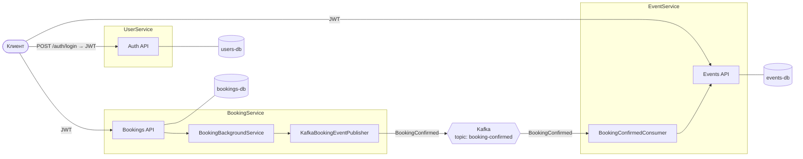

# Yandex API — сервис управления мероприятиями (микросервисы + Kafka)

Учебный проект для [Яндекс.Практикум](https://practicum.yandex.ru/middle-csharp/).

Монолит из прошлых спринтов разделён на **три независимых микросервиса**, которые обмениваются сообщениями через
**Apache Kafka** и не вызывают друг друга по HTTP. История изменений — в [CHANGELOG.md](CHANGELOG.md).

## Содержание

- [Состав системы](#состав-системы)
- [Архитектура](#архитектура)
- [Поток данных BookingConfirmed](#поток-данных-bookingconfirmed)
- [Запуск](#запуск)
- [Проверка сценария целиком](#проверка-сценария-целиком)
- [JWT и роли](#jwt-и-роли)
- [Конфигурация](#конфигурация)
- [Тесты](#тесты)
- [Структура репозитория](#структура-репозитория)
- [Известные ограничения](#известные-ограничения)

## Состав системы

| Компонент | Назначение | Порт на хосте | База данных |
|---|---|---|---|
| [**UserService**](UserService/README.md) | Регистрация, вход, выдача JWT | `5129` | `users-db` (PostgreSQL, `5433`) |
| [**EventService**](EventService/README.md) | CRUD событий, учёт свободных мест, подписка на Kafka | `5128` | `events-db` (PostgreSQL, `5434`) |
| [**BookingService**](BookingService/README.md) | Создание и отмена броней, публикация в Kafka | `5130` | `bookings-db` (PostgreSQL, `5435`) |
| [**Shared**](Shared/) | Общий код: базовые типы, DTO, middleware, `Shared.Contracts` (контракт события и имя топика) | — | — |
| Kafka + Zookeeper | Брокер сообщений | `9092` (с хоста), `kafka:29092` (внутри Docker) | — |

Swagger каждого сервиса: `http://localhost:<порт>/swagger` (в Docker сервисы стартуют в окружении `Development`).

У каждого сервиса **своя база и свой контекст EF Core со своей миграцией**. Внешних ключей между базами нет — сервисы
связаны только идентификаторами (`UserId`, `EventId`, `BookingId`).

## Архитектура

Каждый сервис построен по принципам чистой архитектуры: `Domain ← Application ← Infrastructure ← Presentation`
(зависимости направлены внутрь). Общий код лежит в `Shared`.



Принципы:

- **Никаких синхронных вызовов между сервисами.** Bookings ничего не знает про устройство Events.
- **Согласованность в конечном счёте (eventual consistency).** Места у события уменьшаются не мгновенно, а после
  обработки сообщения из Kafka.
- **Общий JWT.** Токен выдаёт только UserService; EventService и BookingService проверяют его по общим
  секрету, издателю и аудитории.

## Поток данных BookingConfirmed

| Шаг | Кто | Что происходит |
|---|---|---|
| 1 | Клиент → **Bookings** | `POST /bookings` создаёт бронь в статусе `Pending` (`202 Accepted`) |
| 2 | **Bookings** (`BookingBackgroundService`) | Каждые 5 с берёт `Pending`-брони, подтверждает бронь (`Confirmed`) и **сохраняет статус в свою БД** |
| 3 | **Bookings** (`KafkaBookingEventPublisher`) | **Только после сохранения** публикует `BookingConfirmed` в топик `booking-confirmed`. Ключ сообщения — `EventId` |
| 4 | **Kafka** | Сообщения с одним ключом попадают в один раздел и читаются по порядку — брони одного события обрабатываются последовательно |
| 5 | **Events** (`BookingConfirmedConsumer`) | Подписан на топик (группа `event-service`), десериализует сообщение, на каждое сообщение создаёт отдельный scope |
| 6 | **Events** (`BookingConfirmedHandler`) | Если бронь ещё не обработана — уменьшает `AvailableSeats` и записывает `BookingId` в таблицу `ProcessedBookings` (одной транзакцией) |
| 7 | **Events** | Только после успешной обработки фиксирует offset в Kafka |

Крайние случаи обработчик **пропускает с логированием** (подписчик не падает на «плохом» сообщении):

| Ситуация | Поведение |
|---|---|
| Событие не найдено | `Warning` в лог, сообщение пропущено |
| Нет свободных мест | `Warning` в лог, места не меняются |
| Повторная доставка той же брони | Пропуск: места второй раз **не** уменьшаются (идемпотентность по `BookingId`) |
| Некорректный JSON | `Error` в лог, сообщение пропущено |
| Временная ошибка (например, БД недоступна) | Подписчик возвращается к этому сообщению и повторяет через 3 с |

### Контракт события

Лежит в отдельном проекте [`Shared/Shared.Contracts`](Shared/Shared.Contracts), который подключают и издатель, и подписчик:

```csharp
public static class KafkaTopics
{
    public const string BookingConfirmed = "booking-confirmed";
}

public sealed record BookingConfirmed(
    Guid BookingId,      // идентификатор брони
    Guid EventId,        // событие, у которого уменьшаются места
    Guid UserId,         // пользователь, создавший бронь
    int Seats,           // сколько мест занимает бронь
    DateTime ConfirmedAt // момент подтверждения (UTC)
);
```

Пример сообщения в топике (JSON, camelCase):

```json
{
  "bookingId": "7a8b9c0d-1e2f-3a4b-5c6d-7e8f9a0b1c2d",
  "eventId": "3f8c9a2b-1d4e-5f6a-7b8c-9d0e1f2a3b4c",
  "userId": "0b1c2d3e-4f5a-6b7c-8d9e-0f1a2b3c4d5e",
  "seats": 1,
  "confirmedAt": "2026-11-25T10:00:00Z"
}
```

### Топик

Топик `booking-confirmed` создаёт **EventService** при старте (`KafkaTopicInitializer`, hosted-сервис, который
регистрируется раньше подписчика): 3 раздела, фактор репликации 1. Если топик уже существует — создание пропускается; если
создать не удалось — сервис всё равно запускается (после 10 попыток с паузой 3 с). Автосоздание топиков на брокере в
`docker-compose.yml` отключено, поэтому система работает «из коробки» даже на пустом брокере.

## Запуск

### В Docker (одной командой)

Требуется Docker с Docker Compose.

```bash
git clone https://github.com/johsamxd/Yandex.git
cd Yandex
docker compose up --build
```

Поднимутся Zookeeper, Kafka, три базы PostgreSQL и три сервиса (миграции применяются автоматически при старте).
Когда в логах появится `Subscribed to booking-confirmed`, система готова:

- UserService — <http://localhost:5129/swagger>
- EventService — <http://localhost:5128/swagger>
- BookingService — <http://localhost:5130/swagger>

Остановка: `docker compose down` (с удалением данных баз: `docker compose down -v`).

### Локально (сервисы через `dotnet run`, инфраструктура в Docker)

```bash
# только Kafka, Zookeeper и базы
docker compose up -d zookeeper kafka users-db events-db bookings-db

dotnet run --project UserService/UserService.Presentation
dotnet run --project EventService/EventService.Presentation
dotnet run --project BookingService/BookingService.Presentation
```

Строки подключения и адрес Kafka по умолчанию (`localhost:9092`, порты баз `5433/5434/5435`) уже прописаны в
`appsettings.json` каждого сервиса.

### Сборка

```bash
dotnet build Yandex.slnx
```

## Проверка сценария целиком

Удобнее всего в Swagger (кнопка **Authorize**); ниже — то же через `curl`.

**1. Получить токен администратора (UserService)**

Первый администратор создаётся сидом при старте UserService (`AdminSeed`, в Docker по умолчанию `admin` / `admin123`).
Обычный пользователь регистрируется через `POST /auth/register`; роль `Admin` при самостоятельной регистрации запрещена (`403`).

```bash
curl -X POST http://localhost:5129/auth/login -H "Content-Type: application/json" \
  -d '{"login":"admin","password":"admin123"}'
# в ответе — token; дальше он подставляется как TOKEN
```

**2. Создать событие (EventService, роль Admin) и запомнить `totalSeats`**

```bash
curl -X POST http://localhost:5128/events -H "Authorization: Bearer $TOKEN" -H "Content-Type: application/json" \
  -d '{"title":"Конференция по C#","description":"Ежегодная конференция","startAt":"2026-12-01T10:00:00Z","endAt":"2026-12-01T18:00:00Z","totalSeats":10}'
# в ответе — id события (EVENT_ID), availableSeats = 10
```

**3. Создать бронь (BookingService)**

```bash
curl -X POST http://localhost:5130/bookings -H "Authorization: Bearer $TOKEN" -H "Content-Type: application/json" \
  -d "{\"eventId\":\"$EVENT_ID\"}"
# 202 Accepted, status = Pending; дождитесь ~5–10 секунд, пока бронь станет Confirmed
curl http://localhost:5130/bookings/$BOOKING_ID -H "Authorization: Bearer $TOKEN"
```

**4. Убедиться, что места уменьшились (EventService)**

```bash
curl http://localhost:5128/events/$EVENT_ID
# availableSeats = 9 — событие прошло через Kafka
```

Как убедиться, что обмен идёт именно через Kafka, а не по HTTP:

- в логах `booking-service` — `BookingConfirmed for booking … published to booking-confirmed [partition …, offset …]`;
- в логах `event-service` — `Reserved 1 seat(s) for event … (booking …)`;
- в коде нет ни одного HTTP-клиента: `BookingService` не ссылается на `EventService` и наоборот — их связывает только
  `Shared.Contracts`.

Посмотреть сообщения в топике:

```bash
docker exec -it eventapi-kafka kafka-console-consumer --bootstrap-server localhost:29092 \
  --topic booking-confirmed --from-beginning --property print.key=true
```

## JWT и роли

Токен выдаёт **только UserService** (`POST /auth/login`). EventService и BookingService проверяют тот же токен, поэтому
во всех трёх сервисах совпадают параметры секции `Jwt`: `Secret`, `Issuer`, `Audience`.
В Docker они задаются в одном месте — в блоке `x-jwt-env` файла `docker-compose.yml` (переопределяются переменными
`JWT_SECRET`, `JWT_ISSUER`, `JWT_AUDIENCE`).

| Роль | Права |
|---|---|
| **Анонимный** | `GET /events`, `GET /events/{id}`, `POST /auth/register`, `POST /auth/login` |
| **User** | Всё, что анонимный, плюс `POST /bookings`, `GET /bookings/{id}` и `DELETE /bookings/{id}` — только свои брони |
| **Admin** | Всё, что User, плюс `POST/PUT/DELETE /events` и доступ к чужим броням |

| Ситуация | Ответ |
|---|---|
| Эндпоинты броней без токена | `401 Unauthorized` |
| `POST/PUT/DELETE /events` без токена | `401 Unauthorized` |
| `POST/PUT/DELETE /events` с токеном роли `User` | `403 Forbidden` |

Роль `Admin` выдаётся только сидом (`AdminSeed`) или существующим администратором (`POST /auth/register` с токеном админа и `"role":"Admin"`).

Роль лежит в claim `ClaimTypes.Role`, идентификатор пользователя — в `ClaimTypes.NameIdentifier`; сервисы читают их из
токена и не обращаются в UserService.

> **Секрет и пароль админа в `appsettings.json` / `docker-compose.yml` — только для учебного стенда.** В реальной среде используйте user-secrets,
> переменные окружения (`Jwt__Secret`) или хранилище секретов. Секрет должен быть не короче 32 символов.

## Конфигурация

Любое значение из `appsettings.json` переопределяется переменной окружения (`__` — разделитель вложенных ключей).

| Параметр | Сервисы | Описание | Пример в Docker |
|---|---|---|---|
| `ConnectionStrings__DefaultConnection` | все | Строка подключения к **своей** базе | `Host=events-db;Port=5432;Database=events;...` |
| `Jwt__Secret`, `Jwt__Issuer`, `Jwt__Audience` | все | Общие параметры JWT | см. `x-jwt-env` |
| `AdminSeed__Login`, `AdminSeed__Password` | Users | Первый администратор (создаётся при старте, если его нет) | `admin` / `admin123` (`ADMIN_LOGIN`, `ADMIN_PASSWORD`) |
| `Kafka__BootstrapServers` | Events, Bookings | Адрес брокера | `kafka:29092` |
| `Kafka__ConsumerGroup` | Events | Группа потребителей | `event-service` |
| `Kafka__TopicPartitions` / `Kafka__TopicReplicationFactor` | Events | Параметры создаваемого топика | `3` / `1` |
| `BookingBackground__PollingIntervalSeconds` / `ProcessingDelaySeconds` | Bookings | Интервал опроса `Pending`-броней и имитация внешней обработки | `5` / `2` |

Группа потребителей определяет, как сообщения делятся между экземплярами: внутри одной группы каждое сообщение получает
только один экземпляр, поэтому при масштабировании EventService места не уменьшатся дважды. Другим сервисам, которые
захотят читать этот же топик, нужна **своя** группа.

## Тесты

```bash
dotnet test --solution Yandex.slnx
```

- **Юнит-тесты** (`*.UnitTests`) используют InMemory-провайдер EF Core и не требуют внешних сервисов:
  логика пользователей и хеширование паролей (UserService), лимит броней / отмена / доступ к чужой брони и публикация
  `BookingConfirmed` после сохранения статуса (BookingService).
  В EventService — `BookingConfirmedHandlerTests`: уменьшение мест, повторная доставка (идемпотентность), событие не
  найдено, нет свободных мест.
- **Интеграционные тесты** (`*.IntegrationTests`) работают с настоящим PostgreSQL через Testcontainers — нужен запущенный
  Docker. Проверяют репозитории и миграции (в т. ч. что в базе сервиса только его таблицы и нет внешних ключей).

## Структура репозитория

```text
.
├── docker-compose.yml        # Zookeeper, Kafka, 3 БД и 3 сервиса
├── Yandex.slnx               # решение со всеми проектами
├── Shared/
│   ├── Shared.Domain/        # базовая сущность, исключения, роли
│   ├── Shared.Application/   # ApiResponse, пагинация, JwtOptions, KafkaOptions, IUnitOfWork
│   ├── Shared.Contracts/     # ← контракт BookingConfirmed и имя топика
│   └── Shared.Presentation/  # middleware исключений, ответы API, claims
├── UserService/              # Domain / Application / Infrastructure / Presentation / tests, Dockerfile
├── EventService/             # то же + Kafka-подписчик и создание топика
└── BookingService/           # то же + Kafka-издатель
```

В каждой папке сервиса есть свои `README.md`, `CHANGELOG.md` и `Dockerfile` (многоступенчатая сборка; контекст сборки —
корень репозитория, так как нужна папка `Shared`).

## Известные ограничения

- **Нет outbox.** Бронь сначала сохраняется как `Confirmed`, и только потом публикуется событие. Если Kafka недоступна
  дольше трёх попыток публикации, событие теряется (бронь останется подтверждённой, а места не уменьшатся).
  Надёжное решение — паттерн Transactional Outbox.
- **Нет компенсации.** Отмена подтверждённой брони пока не возвращает места (нужно событие `BookingCancelled`).
- **Нет синхронных проверок между сервисами.** Bookings не проверяет, что событие существует и ещё не началось, а Events
  при нехватке мест просто пропускает сообщение. Бронь на несуществующее событие тоже станет `Confirmed`.
- Одна бронь занимает одно место (`Seats = 1`).
